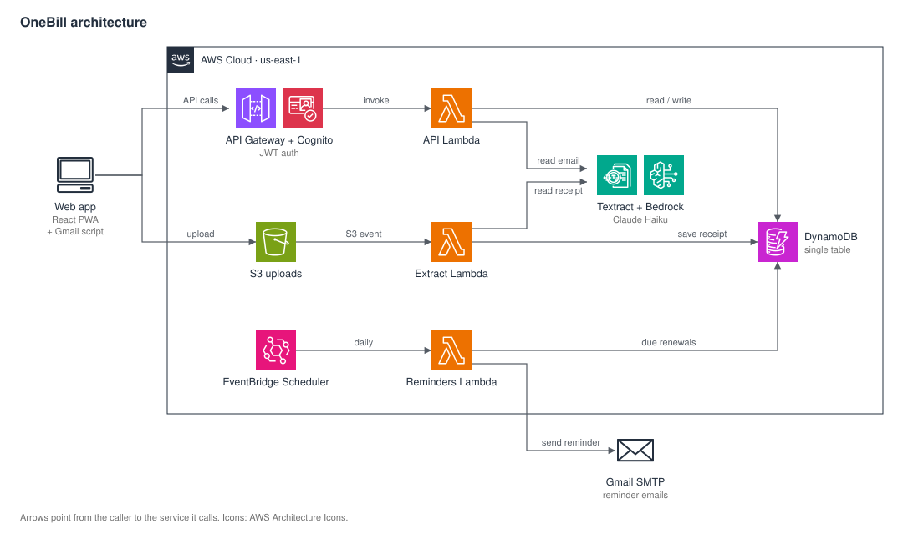

# OneBill

https://github.com/AndyHuynh24/OneBill/issues/3#issue-5832442970 

Scan a receipt, split it with friends, and keep track of subscriptions and bills, all from one Scan button. Live at [one-bill.web.app](https://one-bill.web.app).

- **Scan:** take a photo or upload a PDF. Textract reads the text, an LLM labels each line
  (item, tax, tip, discount...), and plain code does the math and checks it against the
  printed totals. Lines that don't add up are flagged, never dropped.
- **Split:** pick who was there, tap who had what, and tax and tip are shared in proportion.
- **Subscriptions and bills:** a small Gmail Apps Script sends labelled emails to the API. OneBill reads the service, amount, and renewal date, and emails a reminder before it renews.

## Architecture



- **AWS:** API Gateway (HTTP API), Lambda, DynamoDB, S3, Cognito, Textract, Bedrock (Claude Haiku), EventBridge, and CloudFront. Reminder emails go out through Gmail SMTP.
- **Infra:** AWS CDK (TypeScript), six stacks: Data, Auth, Api, Pipeline, Web, Account.
- **Backend:** Python 3.12 Lambdas with AWS Lambda Powertools; dependencies managed with `uv`.
- **Frontend:** React, TypeScript; installable as a PWA.
- **CI:** GitHub Actions runs lint, tests, and `cdk synth` on every pull request.

## Design choices

- **The model classifies, code computes.** The LLM only labels lines and pulls out dates;
  totals, splits, and checks are deterministic.
- **Every query is scoped to the caller.** The user ID comes from the verified JWT, never from
  the request body or the model.
- **Personal data stays out of prompts and logs.** Card numbers, account numbers, emails, and
  the customer's name and address are masked before any model call. Photos are deleted once
  they've been read. Secrets such as the Gmail app password live in SSM Parameter Store.
- **Built to cost a few dollars a month.** No NAT gateways, no provisioned capacity, and no
  always-on compute. Per-user daily limits and app-wide monthly limits cap the worst case,
  and an AWS Budget alerts early.
- **Idempotent event handling.** Every state change is a conditional write, so a retried S3,
  SNS, or email event can't process a document twice, and events that keep failing wait in an
  SQS dead-letter queue instead of being lost.

## Repository layout

```
frontend/      React app
infra/         CDK app (bin/, lib/ stacks, test/)
services/      Lambda code: api/, documents/, split/, subscriptions/, reminders/, shared/
eval/          Extraction accuracy evaluation against labelled receipts
integrations/  Gmail Apps Script for subscription emails
```

## Getting started

Requirements: Node 24, Python 3.12, and an AWS account
with the CDK bootstrapped.

```bash
make install          #Python and Node dependencies
make test             #pytest + vitest
make lint             #ruff + eslint + tsc
make synth            #validate the CDK app

cd infra && npx cdk deploy --all
make frontend-env     
make dev              
```

